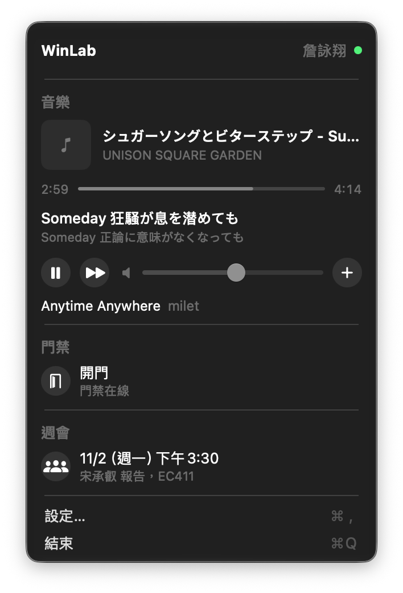
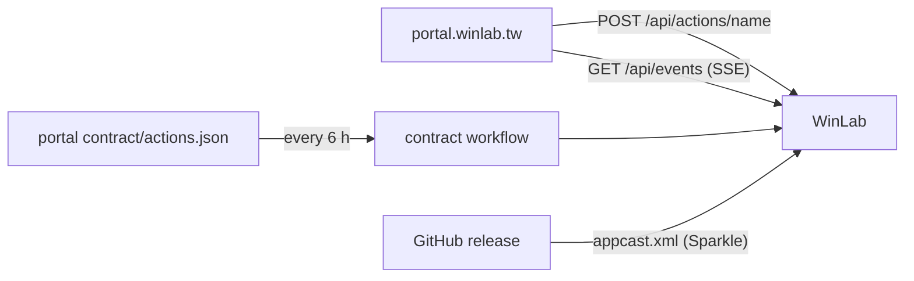

<div align="center">

<h1>WinLab</h1>

<p><strong>The lab's music, door, meetings and bento orders in your Mac menu bar.</strong></p>

[](https://github.com/NYCU-WinLab/menubar/actions)
[](https://github.com/NYCU-WinLab/menubar/releases)
[](LICENSE)

**English** | [繁體中文](README.zh-TW.md) | [简体中文](README.zh-CN.md)

</div>

<p align="center"></p>

WinLab members can see and control the lab without opening portal.winlab.tw. The menu follows the portal live: a new song, an opened bento order or a new announcement shows up within a second.

## Features

- **Controls the lab music**: the playing song, pause, next, volume and the queue.
- **Opens the door**: one click, or a global shortcut you choose.
- **Shows the next lab meeting**: date, presenter, room and the Teams link, with a reminder before it starts.
- **Surfaces what needs you**: open bento orders you have not ordered from, your meetings in the next days, announcements from the last week.
- **Updates itself**: signed, notarized releases through Sparkle; a portal API change also triggers an update check.

## Quick start

1. Download `WinLab-<version>.dmg` from the [latest release](https://github.com/NYCU-WinLab/menubar/releases/latest) and drag WinLab to Applications.
2. Create an API key at [portal.winlab.tw/api-keys](https://portal.winlab.tw/api-keys) with 個人資料, 點歌, 開門, 會議, 便當 and 公告.
3. Open WinLab, choose 設定 API 金鑰 in its menu, paste the key.

The WinLab mascot appears in the menu bar, and its menu shows the song playing in the lab.

## Usage

- **Pause or skip**: the buttons under the song, or ⌃⌥⌘P and ⌃⌥⌘→ from any app.
- **Change the volume**: the slider, or ⌃⌥⌘↑ and ⌃⌥⌘↓.
- **Open the door**: 開門 in the menu; give it a shortcut in 設定… > 快捷鍵.
- **Order bento**: choose the restaurant in the menu, pick a dish and options, 點餐.

## Configuration

Everything lives on one page in 設定… (⌘,).

| Setting | Sets | Default |
|-----|------|---------|
| API 金鑰 | The portal API key, kept in the login keychain | none |
| 登入時開啟 | Start WinLab at login | on |
| 選單列顯示歌名 | The playing song's title beside the menu bar icon | on |
| 通知 | New announcements, open bento orders, a reminder 10 minutes before the lab meeting | on |
| 快捷鍵 | Global shortcuts; F1 to F20 work alone | pause, next, volume |

## How it works



WinLab calls portal actions with the member's API key and listens to `/api/events` for changes in the key's apps. Its Swift types are generated from the portal's API contract, so a portal change that would break the app fails portal CI, and a compatible change arrives here as a pull request. Merging a release pull request publishes the release: GitHub Actions signs it with the Developer ID, notarizes it and signs the Sparkle appcast, with keys kept as secrets of the `release` environment.

## For AI agents

Facts for coding agents and LLM tools. The rules for changing the code are in [AGENTS.md](AGENTS.md).

- **Summary**: A macOS menu bar app for NYCU WinLab members, built on the portal.winlab.tw API.
- **Type**: app
- **Interfaces**: HTTP client of `https://portal.winlab.tw/api/actions` and `/api/events`
- **Install**: download the DMG from the latest GitHub release
- **Run**: `scripts/dev-run.sh`
- **Verify**: `swift test && swift run ContractGen check`
- **Config**: `WINLAB_PORTAL_URL` (development only) points at a test portal
- **Secrets**: the member's portal API key, in the login keychain (service `tw.winlab.menubar`); release signing keys are GitHub secrets of the `release` environment
- **Limits**: macOS 14 or later; the portal decides what a key may do

## Development

```sh
git clone https://github.com/NYCU-WinLab/menubar && cd menubar
swift test
scripts/dev-run.sh
```

CI builds a universal app on macOS, runs the tests and checks that the generated types match the contract.

## License

[MIT](LICENSE)
